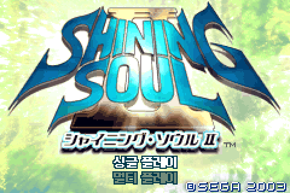
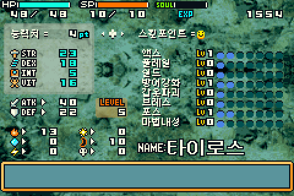
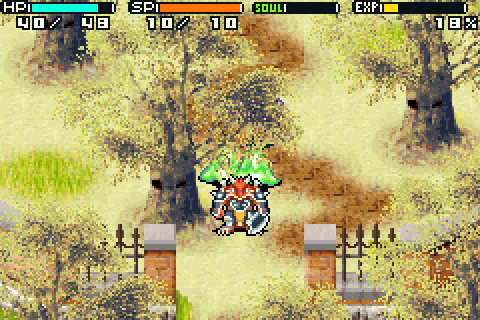

# 샤이닝 소울 II 한글 패치 (GBA 일본판)

GBA 「シャイニング・ソウルⅡ」(Shining Soul II, Japan) 개인용 비공식 한글 패치입니다. 한글 번역과 게임 편의 기능을 포함합니다.

 

> **이 저장소에는 게임(ROM) 데이터가 없습니다.** 변경점(패치)만 들어 있으며, 적용하려면 본인이 정당하게 가진 원본 ROM 이 필요합니다. 원본·패치된 ROM 은 어디에도 올리지 마세요.

## 필요한 원본 ROM

| 항목 | 값 |
|---|---|
| 파일 | Shining Soul II (Japan).gba |
| 크기 | 16,777,216 바이트 |
| CRC32 | `7B39A7B2` |
| MD5 | `3bae05647bbee8565e3993fade2ca5ba` |
| SHA-1 | `19856388caf5140f7527728bd09e20bcb8924eeb` |

패치 결과 ROM: 33,554,432 바이트, CRC32 `5D216AF8`, MD5 `9115241b4cd9fc6f86e9c0b36ed11ff0`

## 적용 방법

### 1) 브라우저 패치 프로그램 (윈도우·맥 공통, 가장 쉬움)
1. [Releases](../../releases) 에서 압축파일을 받아 풀거나, 이 저장소의 `ShiningSoul2_KO_Patcher.html` 을 내려받습니다.
2. HTML 을 브라우저(크롬·엣지·사파리·파이어폭스)로 엽니다. 설치도 인터넷도 필요 없습니다.
3. 본인의 `Shining Soul II (Japan).gba` 를 화면의 상자에 끌어다 놓으면 `Shining Soul II (Japan) 한글.gba` 가 내려받아집니다.
4. mGBA 같은 GBA 에뮬레이터로 실행합니다.

모든 계산은 브라우저 안에서 이뤄지고 ROM 은 어디로도 전송되지 않습니다.

### 2) BPS 패치 도구
`ShiningSoul2_KO.bps` 를 Floating IPS, Rom Patcher JS, flips 등으로 원본 ROM 에 적용합니다.

### 3) 파이썬 스크립트
```
python3 apply_patch.py "Shining Soul II (Japan).gba"
```

자세한 설명과 패치 전후 사진은 [안내서 PDF](docs/ShiningSoul2_KO_Guide.pdf) 를 보세요.

## 패치 내용

### 한글 번역
- 대사·시스템 문장 1,480개, 아이템·장비·적·지명·스킬 이름 1,413개
- 타이틀·파일 선택·START 메뉴·상태창·예/아니오 등 화면 글자와 이미지
- 이름 입력: 한글 자모를 눌러 글자를 조합해 입력, 기본 이름 한글화
- 엔딩 크레딧 직책 번역과 스태프 이름 음역
- 글꼴: 갈무리(Galmuri) 기반 한글 글리프

### 게임 편의 패치
1. 대사 빠르게, **A 로 넘기기**, 대사창 ▼ 표시
2. START 메뉴(상태창·아이템창 포함)를 열면 **월드 정지**(소리 유지, L/R 패널 제외)
3. 스탯·스킬 **재분배**(직업 기본값까지)
4. **저장 후 타이틀로 가지 않고 계속 진행**(BGM 유지)
5. **사망 시 장비 보존**, 소지 골드는 **절반만 손실**
6. 솔로 플레이에서 **내 직업 아이템 드롭**(멀티는 원래대로)
7. 필드 HUD 에 **EXP 막대와 퍼센트**(투기장 제외)



## 알려진 한계
- PC 에뮬레이터에서만 시험했으며 실물 카트리지·플래시카트는 시험하지 못했습니다.
- 멀티플레이 화면 일부(캐릭터 이름 스프라이트)는 한글 대응이 안 되어 있고, 멀티 동작은 시험하지 못했습니다.
- 장비에는 직업 제한 외에 필요 레벨이 있어 레벨이 모자라면 착용할 수 없습니다. 일부 던전 단계의 공용 드롭표에서는 다른 직업 장비가 섞일 수 있습니다.
- 실제 몬스터 드롭, 경험치 획득 중 막대 변화는 직접 확인하지 못했습니다(함수·화면 단위로 시험).
- 번역에는 오역이 있을 수 있습니다.

## 버전 기록
- **v1.1**: 필드에서 플레이하다 보면 크게 느려지던 문제 수정(추가 코드의 처리량 축소)
- v1.0: 첫 공개

## 크레딧·라이선스
- 원작: SEGA / SONICTEAM 「シャイニング・ソウルⅡ」. 이 패치는 원작과 무관한 팬 번역입니다.
- 글꼴: [Galmuri](https://galmuri.quiple.dev/) — SIL Open Font License 1.1
- 시험 환경: mGBA

개인 학습·소장 목적의 비공식 패치입니다. 상업적 이용과 ROM 배포를 금지합니다.
